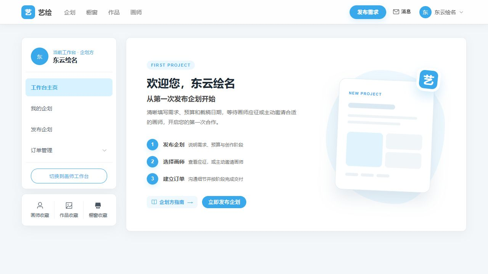
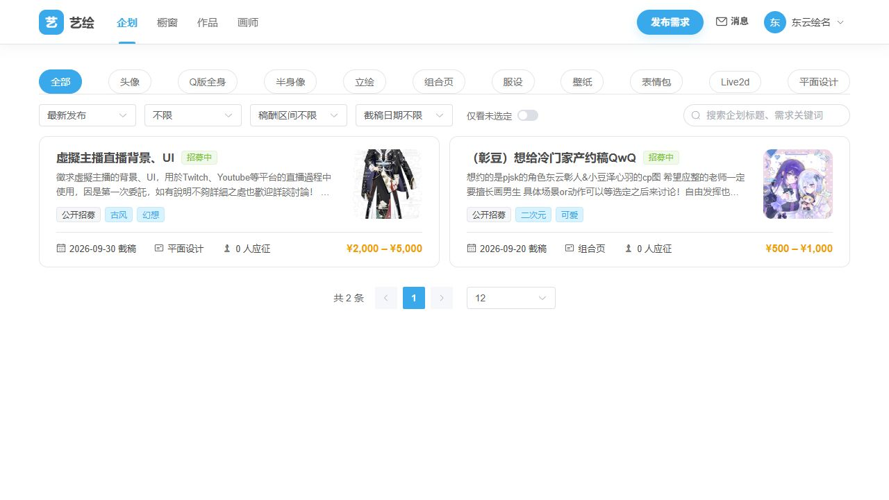
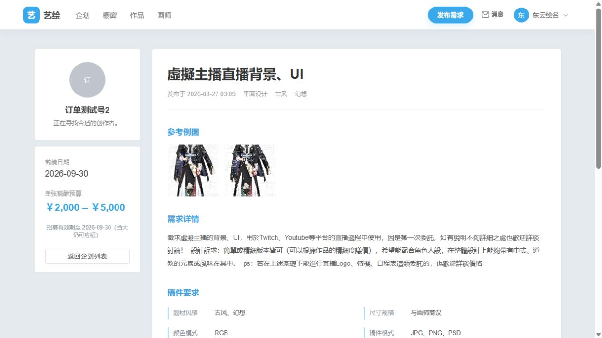
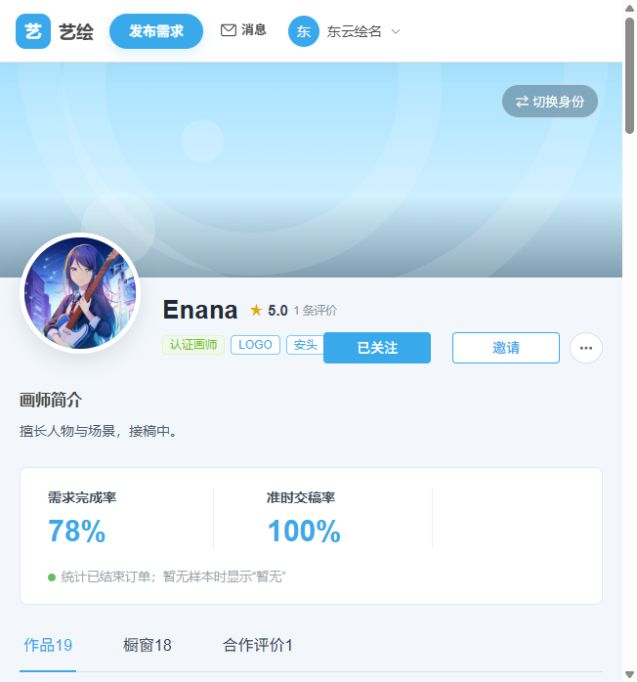
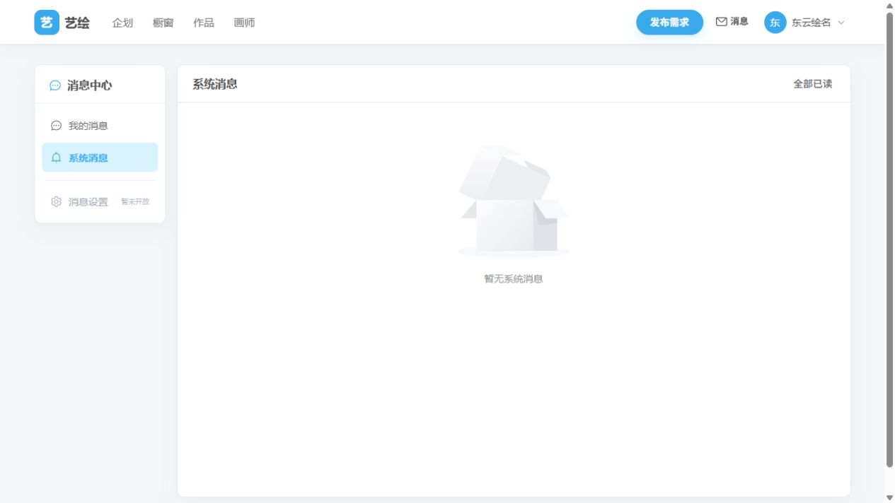
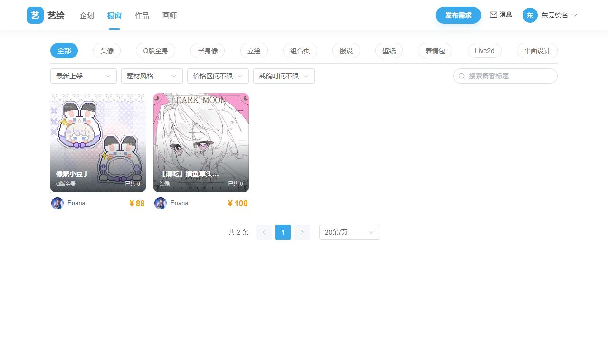
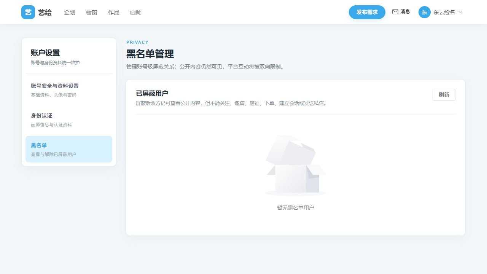

# 艺绘（Artiv）功能模块说明（图文版）

> 当前版本：`v0.8.13-beta`
> 文字最近核对：2026-09-05，代码基准 `fec304f`；截图仍为 2026-08-27 的历史演示快照，本轮未启动页面或重新截图。
> 说明：本文件用于快速认识项目界面与核心模块。截图中的账号、企划、金额和数量不是当前数据库事实，局部入口可能已经变更。当前规则以实际代码、[功能说明](功能说明.md)和[接口文档](接口文档.md)为准，开发计划用于追溯设计。

本版截图使用“订单测试号2”发布企划、使用“Enana”发布画师橱窗，以接近真实约稿场景的标题、说明和参考图替代早期通用测试数据。

## 1. 项目概览

艺绘是一个面向企划方和画师的美术约稿平台。用户使用同一账号在两种工作台之间切换，通过企划招募、主动邀请或画师橱窗建立合作，并在平台内完成沟通、下单、分阶段交付、验收、结算和评价。

核心闭环如下：

1. 企划方发布公开企划或定向企划，也可以从画师主页主动邀请画师。
2. 画师应征企划、回应邀请，或通过橱窗提供标准化绘画服务。
3. 双方在站内会话中沟通，由企划方创建订单并托管模拟金额。
4. 画师按创作阶段提交稿件，企划方逐阶段验收。
5. 订单完成后结算并开放 7 天双方评价；争议在进行中/待验收阶段发起，完成后没有通用退款重开流程。

## 2. 双身份工作台

同一账号可以使用企划方和画师两种身份。工作台根据当前身份展示对应快捷入口、业务记录和待处理事项；新账号没有企划或订单时，会显示简洁的新手引导。

企划方工作台主要用于：

- 发布和管理企划；
- 查看应征画师与邀请结果；
- 管理企划订单和橱窗订单；
- 快速进入消息、收藏及平台指南。

画师工作台则集中展示作品、橱窗、有效应征、收到的邀请和承接订单。未完成画师认证时，页面提供资料完善、作品上传和认证指南入口；认证通过后开放完整接稿能力。

## 3. 企划大厅与筛选

企划大厅展示仍在招募有效期内、正常公开上架的企划。用户可按稿件类型、排序、预算、截稿日期和是否已选定画师进行筛选。

企划卡片会展示标题、封面、类型、截稿日期、应征人数、预算区间和招募状态。超过截稿日期的企划会由后端从大厅结果中排除，但不会影响已经产生的应征、会话和订单。

## 4. 企划详情、应征与邀请

企划详情集中展示委托方信息、预算、截稿日期、参考例图、需求说明、稿件参数和创作阶段。公开企划允许认证画师应征；定向企划和公开企划主动邀请则根据邀请类型展示接受、拒绝或进入普通应征的入口。

目前支持三类邀请：

- **定向邀请**：企划创建时指定一名画师，画师接受后生成应征并建立会话；
- **邀请报价**：邀请画师关注公开企划，由画师填写报价后形成普通应征；
- **带价邀请**：企划方预设邀请价格，画师接受后按该价格生成锁价应征。

邀请不会直接创建订单。双方先形成有效应征和会话，再由企划方按现有公开企划流程发送订单。

当前公开详情以展示为主，企划方从“我的企划 → 企划面板”管理应征、参与画师、邀请、日期及上下架；完整内容编辑受业务关联约束，删除使用“我的企划”的独立弹窗。历史截图不代表这些最新入口已被截图覆盖。

## 5. 画师公开主页与合作入口

画师公开主页用于集中展示认证状态、擅长标签、个人简介、需求完成率、准时交稿率、作品、橱窗和公开合作评价。

企划方可以在主页进行关注或发起公开企划邀请。更多菜单提供加入黑名单、解除屏蔽和举报用户入口；这些治理能力按整个账号生效，而不是只限制某一种身份。

公开主页不以画师认证为访问门槛，认证控制应征、开橱窗和接单等接稿能力。当前需求完成率计算将争议中订单纳入分母，指标口径仍待确认，不能只凭截图比例作为验收依据。

## 6. 消息中心

消息中心分为“我的消息”和“系统消息”两部分：

- **我的消息**：双方普通私信、业务系统提示和订单状态卡片；
- **系统消息**：邀请、应征、接单、交付、验收、退款、仲裁、评价等独立通知。

邀请接受或普通应征发起沟通后，会建立或复用双方会话。业务对象在系统文案中使用统一符号和品牌色强调，帮助用户快速识别画师名、企划标题、订单标题和创作阶段。

## 7. 橱窗与订单交易

画师可创建绘画橱窗，填写服务名称、价格、库存、截稿时间、创作阶段、稿件参数、封面和详情图。企划方购买橱窗或从企划应征中选择画师后，都会进入统一的订单模块。

橱窗大厅支持按类型、题材风格、价格和截稿时间筛选，并在卡片上直接展示服务封面、名称、画师、价格与销量。点击卡片后可查看完整服务说明和稿件参数，再进入购买流程。

订单主流程为：

`待接单 → 创作阶段 → 阶段交付与验收 → 完成结算 → 双方评价`

平台支持：

- 模拟余额托管与完成结算；
- 多个自定义创作阶段；
- 图片稿件、水印预览与原图开放；
- 企划方提前确认当前交付并直接完成；
- 退款、售后、争议仲裁与管理员审计；
- 订单完成后的双方评价和评价申诉。

企划当前是否过期、下架或重新编辑，不会反向改变已经创建的订单，订单始终按照自己的状态机运行。

## 8. 账户资料、认证与黑名单

账户设置管理头像、昵称、简介、密码及认证资料。已认证画师修改正式笔名和常用站会提交变更审核，审核期间保留原认证身份；不是所有昵称、简介或头像修改都需要重新审核。

黑名单采用账号级双向互动限制：双方仍可查看公开主页、大厅和历史记录，但不能继续关注、邀请、应征、下单、建立会话或发送普通私信。存在非终态订单时禁止加入黑名单，避免中途阻断正在履约的合作。

## 9. 管理员治理

管理员后台承担平台治理和高风险业务处理，包括：

- 画师认证审核；
- 用户封禁和限时解封；
- 企划内容治理；
- 订单争议、退款与结算仲裁；
- 评价删除申诉；
- 用户举报聚合与处理；
- 平台统计和管理员操作审计。

管理员处理用户举报时只记录结论，不自动触发封禁或内容下架；处罚仍通过对应治理功能执行并留下独立审计记录。

## 10. 当前版本边界

- 所有余额、托管和结算均为毕业设计环境中的模拟资金，不接入真实支付。
- 带价邀请当前使用平台固定最低价 ¥50，尚未开放个人最低邀请价格设置。
- 举报第一期只支持举报用户账号，不支持作品、企划和橱窗举报，也不向举报人反馈处理结果。
- 仲裁第一期支持全额退款企划方或全额结算画师，不支持部分退款。
- 消息设置、客服及部分资金入口仍为占位；移动端侧栏重构不在当前范围，窄屏基本可用性仍需回归。
- 水印和原图开放当前只体现在详情响应及页面，上传文件直链尚未鉴权；私信有拉黑校验但无上下文发送时缺少业务关系准入。安全、并发和幂等问题详见 [未解决问题](未解决问题.md)，不能以界面闭环等同发布就绪。

## 11. 延伸阅读

- [功能说明](功能说明.md)：完整的功能范围和业务边界。
- [功能流程索引](功能流程/README.md)：订单、企划和橱窗的详细状态流转。
- [开发计划索引](开发计划/README.md)：各模块的设计、实现与验收记录。
- [接口文档](接口文档.md)：后端接口、权限及错误语义。
- [项目进度](项目进度.md)：版本里程碑和提交历史。
- [测试记录](测试.md)：自动化、构建、浏览器和高风险链路验证结果。
