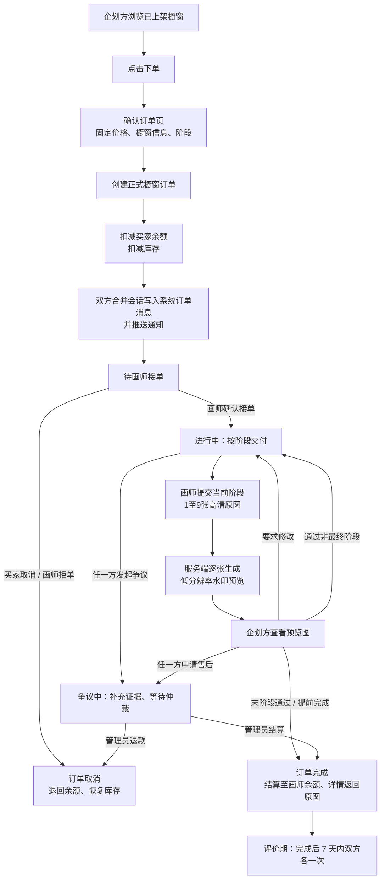
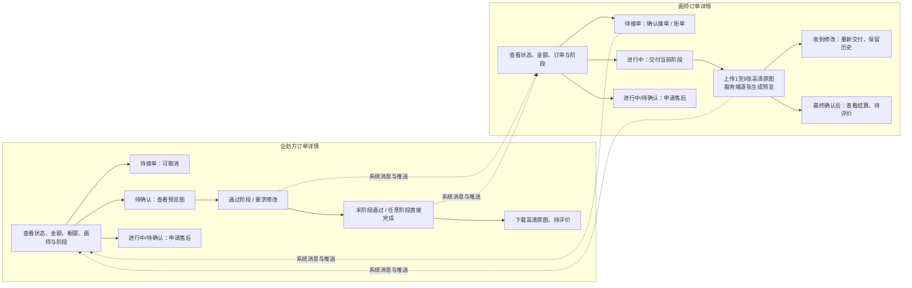

# 艺绘（Artiv）橱窗订单交易流程

> 版本：v1.3
> 最后核对：2026-09-05，依据 `fec304f` 的订单服务、控制器及页面；仅静态同步，历史运行记录保留原日期。
> 范围：覆盖「橱窗下单 → 阶段交付 → 确认收货 → 完成后 7 天双方评价」；企划应征属于企划订单的前置招标流程。
> 流程图源文件：[橱窗订单交易状态流转.mmd](橱窗订单交易状态流转.mmd)、[橱窗订单详情角色流程.mmd](橱窗订单详情角色流程.mmd)

## 1. 已确认业务规则

1. 橱窗价格固定，以已上架橱窗当前显示的价格为唯一订单金额；本轮不支持议价或修改订单金额。
2. 企划方点击橱窗“下单”后，先进入确认订单页，仅确认橱窗、价格、阶段及交易规则，不填写委托备注。
3. 确认下单即创建正式橱窗订单：直接扣减企划方可用余额和橱窗库存，并向双方的**合并私聊会话**写入系统订单消息及推送通知；没有独立冻结余额字段。
4. 画师确认接单后，订单进入进行中；画师按橱窗预设 `phases` 逐阶段交付。
5. 每个阶段版本上传 1–9 张原图，服务端生成最长边不超过 1080px 的重复水印验收图。完成前详情 DTO 隐藏原图，完成后返回历史提交原图；页面展示当前确认版本。`/uploads/**` 仍公开，不能将此描述为原图文件已经受鉴权保护。
6. 企划方对每阶段可“通过”“要求修改”或“确认当前交付并完成交易”；允许从初稿等任意阶段直接完成并跳过后续阶段。
7. 页面要求修改时填写意见，服务端目前允许空意见并使用默认消息；画师详情显示意见，重提会追加版本而非覆盖旧稿。
8. 待接单阶段企划方可取消、画师可拒单，事务内退款并恢复库存；没有自动超时未接取消机制。
9. 进行中或待确认阶段，双方均可通过统一争议入口发起争议并补充证据，管理员可全额结算或退款；不再是只记录状态的客服占位。
10. 最终阶段由企划方确认收货后，订单完成：冻结金额结算至画师余额，开放高清原图，双方分别进入 7×24 小时评价期；每方最多评价一次，逾期不生成默认评价。

## 2. 交易状态与资金、库存

| 状态 | 含义 | 余额 / 库存 | 可进入的下一状态 |
| --- | --- | --- | --- |
| 待画师接单（0） | 已创建订单 | 买家余额已扣减；库存扣减 1 | 进行中、已取消 |
| 进行中（1） | 等待当前阶段交付 | 未结算；库存不变 | 待验收、争议中 |
| 待验收（2） | 等待企划方验收 | 未结算；库存不变 | 进行中、已完成、争议中 |
| 已完成（3） | 最终阶段通过、提前完成或仲裁结算 | 增加画师余额；库存不恢复 | 订单终态；评价不会改变订单状态 |
| 已取消（4） | 取消、拒单、仲裁退款或封禁联动 | 退回买家；库存恢复 1 | 终态 |
| 争议中（5） | 等待管理员处理 | 暂不结算；库存不变 | 已完成或已取消；5 不是终态 |

下单通过 `POST /api/v1/stalls/{id}/purchase`，服务端锁定橱窗和付款账户，检查状态、库存、余额及拉黑关系。该接口没有请求幂等键，库存和余额充足时重复请求仍会生成多单，锁库存不等于重复请求只产生一单。

下单保存价格、标题、封面和 `phase_snapshot`，不是橱窗全部参数与日期的完整快照；`order_stage` 只在实际交稿时追加。

### 2.1 橱窗生命周期与订单隔离

- 大厅只展示“已上架且库存大于 0”的橱窗；下架或售罄后不再接受新订单。
- 下架只改变橱窗公开展示状态，不改变既有订单、订单快照、库存扣减结果或履约状态。
- 所属画师始终可从“我的橱窗”进入本人未删除的下架/无库存橱窗；已下单企划方可从订单进入对应详情。
- 橱窗存在待接单、进行中、待验收或退款/售后订单时禁止删除。只有关联订单全部已完成或已取消后，画师才能删除橱窗。

## 3. 订单管理与详情页

订单管理复用当前工作台路径：

- 企划方：`/dashboard/orders`
- 画师方：`/painter/orders`

企划方工作台只显示“我委托的订单”并固定查询本人作为企划方参与的订单；画师工作台只显示“我承接的订单”并固定查询本人作为画师参与的订单。需要查看另一身份的订单时先切换工作台，不能通过 URL 查询参数在当前工作台混看。

内容区一级页签继续统一为“企划订单 / 橱窗订单”，二级筛选继续为“全部订单 / 待交付 / 待评价 / 退款/售后”。订单详情根据当前参与方展示操作，返回入口使用“我委托的订单 / 我承接的订单”身份文案。

### 3.1 企划方订单详情

- 查看订单状态、固定金额、橱窗信息、画师信息、阶段进度和操作记录。
- 查看已提交阶段的全部水印预览图；最终确认收货后逐张下载高清原图。
- 对当前阶段选择“通过”或“要求修改”。
- 最终阶段选择“确认收货”，推动结算和订单完成。
- 待接单时可取消；进行中或待确认时可申请售后/退款。
- 完成后且本人仍在评价期、尚未评价时展示“去评价”；已提交显示评价摘要，逾期显示“评价已过期”。

### 3.2 画师方订单详情

- 待接单时可“确认接单”或“拒单”。
- 接单后查看固定金额、订单要求、阶段进度和沟通记录。
- 依次提交阶段稿：每次上传 1–9 张高清原图，由服务端逐张生成水印低分辨率预览图。
- 收到“要求修改”后，对当前阶段再次提交，不覆盖历史版本。
- 最终阶段通过后查看结算结果；完成后按同一规则显示待评价、已评价或已过期状态。

## 4. 会话与通知

1. 不为同一用户创建多个私聊分身；延续当前“同一用户一条合并私聊会话”的规则。
2. 下单、接单、拒单、取消、每次交稿、要求修改、阶段通过、最终确认、发起售后等事件，均需：
   - 写入订单操作记录；
   - 向双方合并私聊写入系统订单消息；
   - 创建站内推送通知；
   - 刷新订单管理列表与待办数量。
3. 系统订单消息携带 `orderId`、订单来源 `stall` 与事件类型；“查看详情”按当前身份跳转对应订单详情。
4. 聊天扩展栏已实现“发送订单状态”：选择双方关联的一笔订单后发送状态卡片，不创建新的会话。
5. 画师接单正文为 `画师「画师名」已确认接单，订单「橱窗标题」已进入创作阶段。`；阶段提交正文为 `画师「画师名」已提交订单「橱窗标题」的「阶段」，请验收。`。标题来自订单快照，超过 10 字显示前 10 字加 `...`。
6. 企划方主动取消正文为 `订单「橱窗标题」已取消，托管金额已退回：取消理由`；库存仍按取消事务恢复 1 件，画师拒单和管理员终止/仲裁继续使用各自专用正文。

## 5. 两张流程图

### 5.1 橱窗订单交易状态流转

### 5.2 订单详情角色操作流程

## 6. 当前未实现与已扩展范围

- 企划应征转订单和正式履约已实现，见 [企划订单交易流程](企划订单交易流程.md)；
- 议价和订单金额调整；
- 受鉴权保护的原图下载、真实支付、充值提现及资金流水仍未实现，文件授权属于待修风险，不是无需处理的能力；
- 管理员争议仲裁、退款和封禁联动已实现；
- 评价回复、点赞、普通举报和企划方评价申诉；
- 企划下架、删除已实现，并有订单关联保护；并发一致性问题仍见 [未解决问题](../未解决问题.md)。

## 7. 2026-08-13 实施结果

本流程已按代码提交 `c6b6126` 完成首版实现，数据库迁移为 `backend/sql/migrations/20260813_stall_order_flow.sql`。

> 以下第 7～10 节保留各日期的实施记录，包括当时的单图、仅企划方售后等旧规则；现行规则以第 1～6 节为准，不代表本轮重新测试。

- 已实现：固定价下单、简化余额托管、库存扣减、画师接/拒单、企划方取消、多阶段交付与历史版本、修改/通过、最终结算、原图解锁、售后登记、订单事件、双方通知、会话系统消息和订单状态卡片。
- 已联调：测试订单 `#11` 完整走通全部正常路径，后端 32 项测试与前端生产构建通过。
- 与设计术语的差异：当前没有独立“冻结余额”字段，下单时直接扣除企划方可用余额；拒单/取消时返还，最终完成时增加画师余额。
- 仍按第 6 节保持未实现：真实支付与资金流水、源文件上传，以及评价回复/点赞等扩展能力。管理员售后仲裁、企划应征转订单和 F10 评价已在后续阶段完成。

## 8. 评价闭环补充（2026-08-23）

- 订单详情与订单管理“待评价”筛选共用评价对话框，支持 1–5 星、最多 500 字和最多 6 张本站图片。
- 服务端按当前登录人与订单双方推导评价对象，并校验订单完成状态、7 天期限及单方一次；旧单数接口已弃用。
- 评价进入对方对应身份的公开主页与评分统计；画师可申请删除本人收到的不当评价，由管理员批准逻辑隐藏或驳回。

## 9. 交付与提前完成规则调整（2026-08-13）

- 画师每次阶段交付上传 1–9 张原图，不再分别上传预览图和高清原图。
- 服务端逐张转换为最长边不超过 1080px 的低分辨率 JPEG 并叠加重复水印；企划方验收时读取同一版本的全部预览图。
- 原图地址在订单完成前对企划方隐藏。企划方可以“通过并进入下一阶段”，也可以在初稿、修改稿等任意阶段选择“确认当前交付并完成交易”，直接跳过剩余阶段。
- 直接完成与正常终稿完成使用同一结算事务：订单状态改为已完成的同时，款项立即增加至画师余额，并向企划方开放本次交付全部原图。
- 企划方要求修改时必须填写意见；订单返回进行中，画师详情在对应提交卡片中显示修改意见。
- 画师不能申请退款/售后，只显示“联系客服”预留入口；退款/售后仍由企划方发起。
- 合并私聊中的“发送订单状态”不再自动选择第一笔订单，而是列出当前双方共同参与的全部订单供发送者选择。

本轮代码提交：`7b36535 feat: 优化订单单图交付与阶段确认`。

## 10. 库存、下架与删除保护补充（2026-08-13）

- `fd3a515`：公开大厅过滤无库存橱窗；画师可受限修改库存与追加题材；订单列表增加橱窗详情入口和双角色筛选；历史下单方可以进入下架/无库存橱窗。
- `beb70a1`：服务端删除前检查未完成订单，“我的橱窗”同步显示不可删除状态及原因。
- 下架与删除严格区分：下架可随时执行且不触碰订单；删除属于资源终止操作，存在未完成订单时必须拒绝。
- 回归验证：后端 42 项测试、前端生产构建通过；本地订单 `#17` 在橱窗临时下架前后状态不变，历史下单方访问正常。
