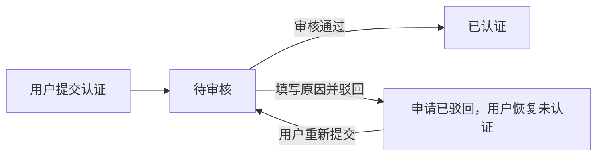
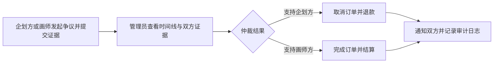

# Artiv 管理员后台设计计划书

> 文档状态：P0–P4 已实现并完成首轮验证
> 编写日期：2026-08-18；实施更新：2026-08-20
> 适用项目：`G:\ProjectForGraduation\Artiv`

## 1. 建设目标

管理员后台不是企划方/画师工作台的复制品，而是 Artiv 平台的运营与风险处理入口。首期目标是让管理员能够处理平台当前已经存在、但普通用户无法自行闭环的事务：

1. 审核画师认证申请。
2. 查询并处置异常用户。
3. 处理订单退款、售后与争议仲裁。
4. 管理违规企划内容，并保留恢复能力。
5. 查看平台真实运营数据与待办数量。
6. 记录所有管理员操作，保证关键变更可追溯。

## 2. 当前项目基础

项目已经具备以下基础：

- 用户角色中已定义管理员角色 `role = 3`。
- 前端已有 `/admin`、`/admin/users`、`/admin/projects`、`/admin/stats` 路由及管理员路由守卫。
- 管理员工作台已有“后台概览、用户管理、企划管理、数据统计”菜单占位。
- 前端已有部分用户管理 API 调用占位，但后端尚无完整的管理员控制器与权限校验实现。
- 数据库已具备用户、作品、橱窗、企划、应征、邀请、订单、阶段、事件、消息、评价等核心业务表。
- 公开注册只允许企划方和画师角色，前后端都不允许普通用户注册为管理员。管理员账号应继续由初始化脚本或受控数据库操作创建。

当前后台页面的数据大多属于静态占位，不能作为真实管理后台直接使用。

## 3. 设计原则

### 3.1 任务优先

管理员登录后首先看到“待处理事项”，而不是装饰性图表。待认证、待仲裁、异常用户和待审核内容必须能直接进入处理页。

### 3.2 后端强制鉴权

前端路由守卫只负责界面体验。所有 `/api/v1/admin/**` 接口必须在后端再次校验管理员身份，不能依赖前端隐藏按钮。

### 3.3 关键操作必须填写原因

认证驳回、封禁用户、解除封禁、下架内容、恢复内容、订单仲裁等操作必须填写原因，并进入审计日志。

### 3.4 不直接破坏业务历史

管理员优先使用“封禁、隐藏、关闭、仲裁”等可追溯状态，不直接物理删除用户、订单、消息和交易记录。

### 3.5 最小隐私访问

管理员默认不能浏览普通用户的完整私聊。只有进入订单争议时，才允许查看与该订单有关的系统事件、交付记录和争议材料；如以后需要查看相关会话，也必须记录访问日志。

### 3.6 封禁不等于注销

封禁用户仍可登录并浏览公开内容、个人主页和历史记录，但不能继续创建新的交易关系。封禁动作发生时，系统立即终止该用户参与的全部未完成订单并将托管金额全额退回下单用户，避免平台截留资金。封禁和订单退款必须使用同一事务或可恢复的幂等流程，并完整记录订单事件、双方通知和管理员审计日志。

## 4. 信息架构与菜单

建议管理员后台采用固定左侧导航、顶部管理员信息区、右侧内容区的传统运营后台结构。列表页以表格、筛选和详情抽屉为主，不使用面向消费者的图片卡片瀑布流。

| 一级菜单 | 路由建议 | 首期范围 |
| --- | --- | --- |
| 后台概览 | `/admin` | 待办入口、核心数量、近期异常 |
| 认证审核 | `/admin/certifications` | 画师认证申请审核 |
| 用户管理 | `/admin/users` | 查询、查看、封禁、解封 |
| 订单仲裁 | `/admin/orders` | 退款/售后/争议处理 |
| 内容管理 | `/admin/content/projects` | 违规企划强制下架、管理员恢复与原因记录 |
| 数据统计 | `/admin/stats` | 用户、企划、订单、成交趋势 |
| 操作日志 | `/admin/audit-logs` | 管理员操作追踪 |

后续可在“内容管理”下增加作品与橱窗管理，但首期先完成企划内容治理。

## 5. 功能设计

### 5.1 后台概览

后台概览是管理员登录后的默认页，强调“现在需要处理什么”，不与数据统计页重复堆叠复杂图表。

#### 第一行：待办与状态卡片

- 待审核画师认证：点击进入认证列表并自动筛选待审核。
- 待处理订单争议：点击进入争议列表并自动筛选处理中。
- 当前封禁用户：点击进入用户列表并自动筛选封禁状态。
- 当前违规下架企划：点击进入内容管理并自动筛选违规下架。
- 当前进行中订单：统计状态为进行中或待验收的订单，点击进入订单列表。

待办卡片显示真实数量和简短状态说明，不计算无可靠对照期的涨跌百分比。

#### 第二行：今日数据

- 今日新增用户。
- 今日新增订单。
- 今日完成订单。
- 今日成交额。

“今日”按系统业务时区 `Asia/Hong_Kong` 的自然日计算。今日成交额只汇总今日完成且当前状态为已完成的订单。

#### 第三行：最近操作

- 展示最近 10 条管理员操作。
- 字段包括操作时间、管理员、操作类型、目标和原因摘要。
- 点击单条记录进入操作日志详情或带筛选条件的日志列表。

#### 交互

- 每个待办数字均可点击，跳转到对应列表并自动带入筛选条件。
- 页面进入时加载一次，提供手动刷新按钮并显示“最后更新时间”；首期不做高频自动轮询。
- 卡片、今日数据和最近操作分别显示加载状态，单个区域失败不阻断其他区域。
- 不显示无法从数据库计算的模拟金额或增长率。
- 请求失败时显示明确错误状态，不回退到假数据。

### 5.2 认证审核

#### 用户提交认证

认证申请页参考常见画师平台的分步流程：`阅读须知 → 画师功能介绍 → 填写认证信息 → 等待审核`。首期不复制无关运营数据，只保留与 Artiv 认证直接相关的步骤。

提交前必须满足：

- 已完善画师公开主页的个人简介。
- 主页至少存在 4 件公开、未删除作品；提交时和管理员审核时均重新校验。
- 填写“笔名”（常用昵称或署名）。
- 必须填写“常用站”（受支持平台的个人主页 URL），供管理员辅助核对身份与作品归属；明显平台首页无效。
- 提交成功后进入审核中，重复点击不得产生并行待审核申请。

#### 列表筛选

- 申请状态：待审核、已通过、已驳回；另支持按初次认证/认证资料修改筛选。
- 用户名/昵称搜索。
- 申请时间范围。

#### 审核详情

- 用户基本资料、个人简介和题材风格。
- 当前公开作品数量。
- 至少展示 4 个公开作品缩略图，并可查看大图。
- 可直接进入该画师在 Artiv 的公开主页。
- 展示本次提交的笔名、常用站和申请时间；常用站作为外部参考信息，不自动采信其内容。
- 历史认证申请与驳回原因。

#### 管理操作

- 通过认证。
- 驳回认证，必须填写原因。
- 审核结果写入系统通知。
- 同一申请只能完成一次终态操作，防止重复提交。
- 审核时若公开作品已不足 4 件，禁止通过并提示管理员驳回或等待申请人补充。

### 5.3 用户管理

#### 列表字段

- 用户 ID、账号、昵称、主要角色。
- 画师认证状态。
- 账号状态：正常/已封禁。
- 注册时间、最后更新时间。
- 关联企划数、作品数、橱窗数、订单数。

#### 筛选

- 账号/昵称模糊搜索。
- 主要角色。
- 认证状态。
- 账号状态。
- 注册时间范围。

#### 管理操作

- 查看用户公开主页和业务概况。
- 封禁用户，必须填写原因，可选择永久封禁或限时封禁。
- 解除封禁，必须填写原因。
- 限时封禁到期后自动恢复正常状态，并记录自动解封日志。
- 被封禁用户仍可登录、浏览公开页面、访问个人主页和历史记录；禁止发布企划、应征企划、创建橱窗、购买橱窗及向既有应征画师发送新订单。
- 执行封禁时立即取消该用户参与的全部未完成订单，将每笔托管金额全额退回对应下单用户；橱窗订单按既定取消规则恢复库存。
- 封禁退款必须幂等，重复执行封禁或重试任务不得重复增加余额。
- 不在首期提供任意修改用户余额、密码、角色的功能。
- 禁止管理员封禁自己；多管理员阶段还应禁止封禁最后一个可用管理员。

### 5.4 订单仲裁

订单仲裁是管理员后台的最高优先级业务模块之一。

#### 列表范围

- 仅展示进入退款/售后/争议状态的企划订单和橱窗订单。
- 支持按订单类型、争议状态、发起方、时间筛选。
- 企划方和画师双方均可主动发起争议。

#### 详情信息

- 订单双方、订单类型、金额、当前状态与创作阶段。
- 订单来源快照：对应企划或橱窗的关键信息。
- 完整订单事件时间线。
- 历次阶段交付、低分辨率水印预览和修改意见。
- 双方提交的争议说明及证据。
- 托管金额当前归属状态。

#### 争议申请与证据

- 发起方必须填写争议说明，可上传 1–9 张图片证据。
- 争议进入处理中后，另一方可以提交一次补充说明和 1–9 张图片证据；后续是否允许追加由接口保留扩展能力。
- 证据文件先复用现有上传接口取得 `/uploads/...` 地址，再写入独立争议证据记录。
- 管理员只能查看该订单的争议说明、证据图片、订单事件和阶段交付，不开放无关私聊内容。

#### 首期仲裁结果

1. 支持企划方：取消订单并退款企划方。
2. 支持画师方：完成结算并将托管金额结算给画师。

首期不做部分退款，但仲裁请求和数据库结果类型应保留未来增加“部分退款”的扩展位置；当前服务端收到未开放的部分退款结果必须明确拒绝。

仲裁提交必须满足：

- 填写处理理由。
- 使用数据库事务更新订单、托管金额、余额和事件记录。
- 具备幂等保护，重复点击不能重复退款或重复结算。
- 同时向双方发送系统通知和会话系统卡片。
- 生成管理员操作日志。

### 5.5 内容管理

首期只管理企划，后续再扩展到作品和橱窗。

#### 列表字段

- 企划 ID、标题、发布者、类型、状态、发布时间。
- 应征人数、关联订单数。
- 平台治理状态：正常/违规下架。

#### 管理操作

- 查看企划详情。
- 管理员将违规企划强制下架，必须填写原因，并向企划发布者发送系统通知。
- 只有管理员可以恢复违规下架企划；发布者本人不能重新上架绕过治理。
- 管理员恢复企划必须填写原因，并通知企划发布者。

“违规下架”应与发布者自己的“上架/下架”分开保存。违规下架后企划不再出现在大厅，也不接受新的应征；既有应征继续保留，企划方仍可与既有应征画师沟通和创建正式订单。已建立订单及订单双方查看来源详情不受影响。

### 5.6 数据统计

数据统计页的首要目标是帮助管理员和开发方理解用户真实需求、供需缺口和功能改进方向，而不是只展示平台规模和成交额。首期不单独建立“开发者角色”，开发方通过受控管理员账号查看同一套聚合数据。

页面分为两个标签：

1. **用户需求洞察（默认）**：分析用户想约什么、预算区间、应征反馈、转化结果和供需缺口。
2. **平台运营**：分析用户、订单、成交额、认证和内容规模。

无论当前选择哪个标签，页面顶部始终展示五项最基础的平台指标：

- 总用户数（当前快照，不随时间范围变化）。
- 新增用户数。
- 新增订单数。
- 完成订单数。
- 成交额。

其中总用户数展示当前平台规模；其余四项按所选时间范围统计。五项指标都不会因默认进入“用户需求洞察”而隐藏。

#### 时间范围

- 默认选择近 7 天。
- 快捷选项：近 7 天、近 30 天。
- 支持自定义开始日期和结束日期，包含首尾两天，最长跨度 366 天。
- 全部日期边界按 `Asia/Hong_Kong` 计算，后端统一生成每日连续时间轴；没有数据的日期返回 0。

#### 需求核心指标

- 发布企划数。
- 有应征企划数与零应征企划数。
- 企划转订单数与企划转化率。
- 至少一笔订单完成的企划数与企划完成转化率。

#### 用户需求洞察

- **类型需求**：企划发布量、企划订单量和已完成订单量按平台统一类型统计，用于判断头像、立绘、服设等需求热度。
- **题材风格需求**：将企划多选题材拆分后统计 Top 10，用于判断日系、古风、场景等风格偏好。
- **预算分布**：按 `500 以下`、`500–1000`、`1000–3000`、`3000 以上` 四档统计企划数量，并展示平均预算、中位预算和最终平均成交金额。
- **截稿周期**：按发布日至截稿日的天数统计 `7 天以内`、`8–14 天`、`15–30 天`、`30 天以上`，识别紧急需求比例。
- **应征反馈**：平均每企划应征人数、有应征企划占比、零应征企划占比、平均首次应征等待时间。
- **需求转化漏斗**：发布企划 → 收到应征 → 创建正式订单 → 至少一笔订单完成。
- **实现需求**：橱窗购买和已完成订单代表已经付费实现的需求，按来源、类型、题材和价格区间统计。
- **供需缺口**：比较各类型的企划需求量、当前在售橱窗数、具备相关公开作品或标签的已认证画师数，突出“需求高但供给少”或“零应征率高”的类型。

需求洞察只使用结构化业务字段，不分析用户私聊、需求描述正文或外部平台内容。

#### 当前规模指标

- 用户总数、当前封禁用户数。
- 已认证画师数、待认证申请数。
- 企划总数、招募中企划数、违规下架企划数。
- 橱窗总数、在售橱窗数。
- 订单总数及各状态分布。

#### 图表

“用户需求洞察”标签：

1. **需求趋势折线图**：每日发布企划数、有应征企划数和创建企划订单数。
2. **需求类型排行**：各类型企划发布量、完成订单量和成交额，默认按企划发布量降序。
3. **题材风格 Top 10**：按企划题材出现次数统计，多选题材分别计数。
4. **预算与截稿周期分布**：预算档位和截稿周期分别使用柱状图。
5. **企划转化漏斗**：发布、收到应征、创建订单、订单完成四层，展示数量和相对上一层转化率。
6. **供需缺口图**：按类型并列展示需求企划数、在售橱窗数、相关已认证画师数，并标记零应征率。

“平台运营”标签：

1. **用户趋势折线图**：每日新增用户；同时显示截至该日的累计用户数。
2. **订单与成交趋势图**：每日新增订单、每日完成订单和每日成交额；成交额使用独立金额坐标轴。
3. **订单状态分布环形图**：所选时间范围内创建的订单，按当前状态分组。
4. **订单来源占比环形图**：所选时间范围内完成的订单，按企划订单、橱窗订单统计数量和成交额。
5. **热门类型 Top 5 横向柱状图**：所选时间范围内已完成订单按企划/橱窗类型合并统计，展示订单数和成交额；不提供画师收入排行。
6. **认证状态分布**：当前未认证、审核中、已认证用户数量，可使用小型环形图或横向条形图；已驳回只统计申请记录，不再作为用户状态。

#### 统计口径

- 需求企划以所选时间范围内 `project.created_at` 为准；定向企划和公开企划均计入总体需求，但类型排行允许按合作方式筛选。
- “收到应征”按企划是否存在任意历史应征记录判断；已撤销或已拒绝应征仍表示该企划曾获得反馈，不因当前有效应征为空而丢失。
- 企划转化漏斗以“唯一企划数”为单位。同一企划向多名画师发出多笔订单时，在“创建订单”和“订单完成”层仍只计一个企划，另在订单趋势中统计真实订单笔数。
- 首次应征等待时间为首条应征 `application.created_at` 减去企划 `project.created_at`；无应征企划不进入平均值。
- 企划转订单率为创建过至少一笔正式订单的企划数 ÷ 发布企划数；企划完成转化率为至少一笔订单完成的企划数 ÷ 发布企划数。
- 预算统计使用企划发布预算；最终成交金额使用已完成订单 `amount`。两者分开显示，不将预算误当成交额。
- 供给画师按当前正常、已认证画师统计；类型供给优先依据其公开作品类型，题材供给依据公开资料标签。在售橱窗按当前未删除、已上架且库存大于 0 统计。
- 供需缺口是产品分析指标，不直接代表画师服务质量；界面必须同时展示原始需求数、供给数和零应征率，不能只给出脱离样本量的单一评分。
- 用户总数和新增用户：仅统计未逻辑删除用户；封禁用户仍计入用户总数，并另列封禁数。
- 新增用户按 `user.created_at` 归属日期。
- 新增订单按 `order_info.created_at` 归属日期，包括之后被取消或进入争议的订单。
- 完成订单和成交额只统计当前 `status=3` 的订单，按 `order_info.completed_at` 归属日期；成交额为 `SUM(order_info.amount)`。
- 取消、待接单、进行中、待验收和争议中订单不计入成交额。
- 订单来源：`project_id` 非空为企划订单，`stall_id` 非空为橱窗订单；异常数据归为“其他”。
- 热门类型通过订单来源关联企划或橱窗类型；当前两类来源的类型字段不允许在下单后修改。来源已逻辑删除仍保留关联统计，无法识别的类型归为“其他”。
- 在售橱窗：未删除、已上架且库存大于 0。
- 招募中企划：未删除、公开招募、发布者处于招募状态且未被管理员违规下架。
- 所有统计由后端聚合查询完成，不允许前端拉取全部业务数据后自行统计。

#### 页面状态

- 无数据时图表仍显示完整日期轴和 0 值，不显示错误占位假数据。
- 请求失败时保留当前时间筛选，显示重试按钮。
- 金额统一显示两位小数；大数可在界面缩写显示，但悬停必须展示完整数值。
- 首期不提供 CSV/Excel 导出。

#### 当前数据边界

当前数据库可以分析“用户实际发布了什么需求”和“哪些需求最终产生应征、订单与成交”，但尚未记录用户只搜索、筛选或浏览而没有发布/购买的兴趣。是否增加搜索词、筛选项和详情访问的匿名行为事件，需单独确认后再扩展，不能用现有数据伪造。

### 5.7 管理员操作日志

所有会改变业务状态的后台操作必须记录：

- 管理员 ID 与账号。
- 操作类型。
- 目标类型和目标 ID。
- 修改前状态、修改后状态。
- 操作原因。
- 操作时间。
- 可选记录来源 IP 和请求标识。

审计日志只读，不能在普通后台界面删除。

## 6. 状态流转

### 6.1 认证审核

### 6.2 订单仲裁

### 6.3 企划治理

## 7. 接口规划

以下接口均要求后端管理员鉴权：

### 7.1 概览与统计

- `GET /api/v1/admin/overview`：返回待审核认证、待处理争议、封禁用户、违规下架企划、进行中订单、今日四项指标及最近 10 条操作日志。
- `GET /api/v1/admin/stats?startDate=2026-08-14&endDate=2026-08-20`：返回始终显示的总用户数、新增用户、新增订单、完成订单和成交额五项基础指标，以及平台运营当前规模、每日趋势、状态分布、来源分布、热门类型 Top 5 和认证状态分布。
- `GET /api/v1/admin/stats/demand?startDate=2026-08-14&endDate=2026-08-20`：返回需求趋势、类型与题材排行、预算与截稿周期、应征反馈、企划转化漏斗和供需缺口。

统计接口要求：

- `startDate`、`endDate` 为空时默认最近 7 天。
- 日期格式为 `yyyy-MM-dd`，开始日期不得晚于结束日期，跨度不得超过 366 天。
- 响应中的每日序列必须补齐缺失日期，前端不自行推导日期。
- 概览与统计接口只读，不写入审计日志；管理员导出功能首期不提供。

### 7.2 认证审核

- `GET /api/v1/admin/certifications`
- `GET /api/v1/admin/certifications/{id}`
- `POST /api/v1/admin/certifications/{id}/approve`
- `POST /api/v1/admin/certifications/{id}/reject`

普通用户侧同步规划：

- `POST /api/v1/users/me/certifications`：提交笔名、必填常用站并创建初次认证申请。
- `POST /api/v1/users/me/certifications/changes`：已认证用户提交笔名/常用站修改申请。
- `GET /api/v1/users/me/certifications/status`：查询三态认证、正式资料、待审资料与实时资格。
- `GET /api/v1/users/me/certifications/latest`：查询本人最新申请及审核结果。

### 7.3 用户管理

- `GET /api/v1/admin/users`
- `GET /api/v1/admin/users/{userId}`
- `PUT /api/v1/admin/users/{userId}/status`

### 7.4 订单仲裁

- `GET /api/v1/admin/orders/disputes`
- `GET /api/v1/admin/orders/{orderId}`
- `PUT /api/v1/admin/orders/{orderId}/arbitrate`

订单双方同步规划：

- `POST /api/v1/orders/{orderId}/disputes`：企划方或画师发起争议并提交说明。
- `POST /api/v1/orders/{orderId}/disputes/evidence`：争议双方提交图片证据。

### 7.5 内容管理

- `GET /api/v1/admin/projects`
- `GET /api/v1/admin/projects/{projectId}`
- `PUT /api/v1/admin/projects/{projectId}/moderation`

### 7.6 操作日志

- `GET /api/v1/admin/audit-logs`

具体请求和响应字段在开发阶段补入《接口文档.md》，未完成或未测试接口必须明确标注。

## 8. 数据库规划

### 8.1 建议新增 `admin_action_log`

用于保存管理员审计记录，建议字段：

- `id`
- `admin_id`
- `action_type`
- `target_type`
- `target_id`
- `before_data`
- `after_data`
- `reason`
- `request_id`
- `ip_address`
- `create_time`

### 8.2 建议新增认证申请历史

当前只在用户表保存认证状态，无法完整表达多次申请、驳回原因与审核人。建议新增 `artist_certification` 表保存：

- 申请人、申请时间。
- 笔名、必填常用站、申请类型，以及资料修改提交时的旧正式值快照。
- 提交时公开主页与作品数量摘要；管理员审核时仍读取当前公开主页和作品重新校验。
- 状态。
- 审核人、审核时间、审核原因。

`user.cert_status` 继续保存当前生效状态，便于业务查询；认证历史表用于审核与追溯。

### 8.3 企划治理字段

企划的发布者上架状态与平台治理状态必须分离。可在企划表增加：

- `moderation_status`
- `moderation_reason`
- `moderated_by`
- `moderated_at`

建议 `moderation_status` 至少区分 `0=正常`、`1=违规下架`。发布者上架接口必须额外校验该字段；只有管理员恢复接口可以清除违规下架状态。既有应征与订单不因该字段被删除或失效。

### 8.4 用户封禁字段

在用户表增加或明确以下字段：

- `status`：`0=正常`、`1=封禁`。
- `ban_reason`：当前封禁原因。
- `banned_by`：执行管理员。
- `banned_at`：封禁时间。
- `banned_until`：限时封禁截止时间；永久封禁为空。

登录不因 `status=1` 被拒绝，但所有创建企划、应征、创建橱窗、购买橱窗和按应征发送新订单的接口必须统一调用业务可用性校验。到期自动解封可采用定时任务加请求时惰性校验双保险。

### 8.5 订单争议与证据

建议新增 `order_dispute` 与 `order_dispute_evidence`：

- 争议记录保存订单、发起人、说明、处理状态、仲裁结果、管理员、处理原因和时间。
- 证据记录保存争议 ID、提交人、图片地址、说明和提交时间。
- 仲裁结果枚举预留部分退款值，但首期服务端只允许“全额退款企划方”和“全额结算画师”。
- 订单只能存在一笔未终结争议；仲裁、封禁退款均使用订单状态和唯一业务记录进行幂等保护。

### 8.6 统计查询索引

为避免统计页面扫描全部业务表，迁移脚本应结合实际查询计划补充索引，至少评估：

- `user(created_at)`、`user(status)`、`user(cert_status)`。
- `order_info(created_at)`、`order_info(completed_at, status)`、`order_info(status)`。
- `project(status, moderation_status, deleted)`、`project(created_at)`。
- `stall(status, deleted)`、`stall(created_at)`。
- `artist_certification(status, created_at)`。
- `order_dispute(status, created_at)`。
- `admin_action_log(created_at)`。

索引以 MySQL `EXPLAIN` 结果为准，避免为了文档清单重复创建低收益索引。

## 9. 开发顺序

### P0：管理员安全底座

- 后端统一管理员鉴权。
- 管理员操作日志表与记录服务。
- 确认管理员只能由初始化脚本或受控操作创建。
- 去除后台静态假数据。

### P1：认证审核与用户管理

- 认证申请历史。
- 认证审核列表和详情。
- 用户查询、封禁与解封。
- 限时封禁、自动解封，以及封禁时未完成订单取消退款。
- 系统通知联动。

### P2：订单争议仲裁

- 争议列表与详情。
- 双方发起争议及图片证据提交。
- 订单证据、交付记录和事件时间线。
- 退款/结算事务与幂等校验。
- 双方通知与审计日志。

### P3：企划内容治理

- 管理员违规下架与恢复企划，发布者不可自行绕过。
- 治理状态与发布者上下架状态分离。
- 已建立订单的来源详情不受影响。

### P4：真实数据统计

- 概览待办、今日数据和最近 10 条管理员操作。
- 默认近 7 天，支持近 30 天及最长 366 天的自定义范围。
- 用户、订单、成交趋势，订单状态和来源占比，认证状态分布。
- 已完成订单热门类型 Top 5；不制作画师收入排行。
- 聚合查询、日期补零、错误重试和统计索引验证。
- 用户需求洞察：类型、题材、预算、截稿周期、应征反馈和企划转化漏斗。
- 供需缺口：企划需求与当前认证画师、在售橱窗供给对比。

## 10. 首期明确不做

- 读取所有用户私聊内容。
- 任意修改用户余额。
- 后台直接修改用户密码或主要角色。
- 多级管理员 RBAC 权限系统。
- 批量封禁、批量下架等高风险批处理。
- 复杂财务报表、发票、提现审核。
- 作品与橱窗的完整举报审核体系。
- Excel 导出和高级运营画像。
- 订单部分退款；仅在接口和结果枚举中预留扩展位置。

这些功能只有在真实运营需要出现后再设计，避免毕业设计阶段扩大到无法验证的范围。

## 11. 验收标准

1. 普通用户即使手工请求管理员接口，也会被后端拒绝。
2. 管理员可完成一次画师认证通过和一次带原因的驳回。
3. 管理员可永久或限时封禁、解封用户；被封禁用户仍能登录和浏览，但不能发布企划、应征、创建橱窗、购买橱窗或按应征发送新订单。
4. 封禁用户时，该用户参与的全部未完成订单只取消和退款一次，金额全额回到对应下单用户，橱窗库存按规则恢复。
5. 企划方和画师均可发起争议、提交说明和图片证据；管理员可完成一次全额退款和一次画师结算，余额只变化一次。
6. 仲裁结果会产生订单事件、双方通知和管理员审计日志。
7. 管理员违规下架的企划不会出现在大厅且发布者不能自行上架，但既有应征仍可沟通和发单，已建立订单双方仍能查看来源详情。
8. 概览与统计全部来自真实数据库，不包含写死数据；待办卡片可进入正确筛选后的管理列表。
9. 默认近 7 天、近 30 天和自定义时间范围均能返回连续日期序列，空日期为 0，跨日边界按 `Asia/Hong_Kong` 计算。
10. 总用户数、新增用户、新增订单、完成订单和成交额五项基础指标在“用户需求洞察”和“平台运营”两个标签中始终可见；总用户数为当前快照，其余四项随时间范围同步刷新。
11. 成交额只汇总所选时间内完成且当前状态为已完成的订单，并能与数据库按 `completed_at` 汇总结果一致。
12. 热门类型 Top 5 只统计已完成订单，不展示画师收入排行；首期没有导出入口。
13. 需求洞察可按类型、题材、预算和截稿周期解释用户发布需求，并能从发布企划追踪到应征、下单和完成；多画师订单不会重复放大企划漏斗。
14. 供需缺口同时展示需求数、供给数和零应征率，不使用无样本量依据的单一结论。
15. 所有管理员状态变更均能在操作日志中查询。

## 12. 已确认决策

1. **管理员来源**：仅初始化脚本或受控数据库操作创建，普通注册不能选择管理员。
2. **认证申请**：参考分步申请页；申请人需完善画师简介并保留至少 4 件公开作品，提交笔名和受支持的外部个人主页；管理员可查看主页、作品、提交信息及资料修改新旧差异。
3. **封禁规则**：封禁用户仍可登录和浏览，但不能发布企划、应征、创建橱窗、购买橱窗或按应征发送新订单；封禁时立即终止其全部未完成订单并全额退款下单用户。支持永久和限时封禁。
4. **争议发起与证据**：企划方和画师均可发起争议，双方可上传图片证据。
5. **仲裁结果**：首期只实现全额退款企划方、全额结算画师；部分退款只预留接口与枚举位置。
6. **企划治理**：违规企划由管理员强制下架并通知发布者，发布者不能自行重新上架；不接受新应征，但既有应征仍可沟通和发单，已有订单不受影响。
7. **内容治理范围**：首期只治理企划，作品和橱窗后续扩展。
8. **数据页面**：总用户数、新增用户、新增订单、完成订单和成交额作为跨标签始终可见的顶部基础指标；统计默认进入“用户需求洞察”，分析类型、题材、预算、截稿周期、应征反馈、转化漏斗和供需缺口；“平台运营”保留更完整的用户、订单、成交、状态与来源数据。
9. **数据边界**：成交额只计算已完成订单；不做画师收入排行，不做 CSV/Excel 导出。
10. **隐私边界**：首期需求分析只使用企划、应征、橱窗和订单的结构化字段，不读取私聊、需求正文或外部平台内容。

## 13. 实施结果（2026-08-20）

管理员后台首期已按 P0–P4 完成编码，不再是规划占位：

- P0：`AuthInterceptor` 对 `/api/v1/admin/**` 从数据库重新校验管理员角色与账号状态；新增 `admin_action_log` 和统一审计服务；后台概览移除全部静态假数据。
- P1：分步认证申请要求画师简介、至少 4 件公开作品、笔名和必填常用站；管理员可查看主页、作品、历史和资料修改差异并通过/驳回。用户侧只保留未认证/审核中/已认证三态，已认证资料修改通过前旧正式值继续生效（`c1a629c`）。用户管理支持永久/限时封禁、定时加惰性自动解封；封禁事务会退款未结束订单并恢复库存。
- P2：企划方和画师均可发起争议，双方各提交一次 1–9 张图片证据；管理员详情不读取无关聊天，只提供全额退款企划方或全额结算画师，部分退款扩展值保留并明确拒绝。
- P3：企划新增独立治理状态；违规下架从公开入口隐藏并禁止新应征，发布者不能自行恢复，老应征发单和已有订单来源访问不受影响。
- P4：概览、用户需求分析和平台运营统计均读取真实数据库；两个统计标签均展示总用户、新增用户、新增订单、完成订单和成交额，另含趋势、分布、漏斗、零应征率和供需缺口。

数据库增量脚本为 `backend/sql/migrations/20260820_admin_backend.sql`，已在 MySQL 8.0.41 上连续执行两次验证。全新建库结构同步至 `backend/sql/init.sql`。脚本会把迁移前的审核中认证和旧售后订单补进新队列，不删除现有记录。

验证结果：后端 **67 项测试通过**；前端生产构建通过；管理员与普通用户接口权限冒烟通过；浏览器逐页验证 7 个后台入口和两类统计标签无控制台错误。需求页已增加企划/在售橱窗类型饼图，并把漏斗优化为带相邻转化率的阶段路径。高风险资金操作的完整双账号端到端测试仍按《测试.md》第 6.4 节使用专用测试数据补回归。

## 14. F10 评价申诉扩展（2026-08-23，已实现）

评价体系开发时，管理员后台新增“评价申诉”治理能力，详细规则以[《评价系统设计计划书》](评价系统设计计划书.md)为准：

- 新增 `/admin/review-appeals` 菜单与“待处理评价申诉”概览待办。
- 首期只允许画师对自己以画师身份收到的评价申请删除；一条评价最多一笔申诉。
- 管理员详情可查看评价、评价图片、订单摘要和申诉理由，不默认读取无关私聊。
- 管理员只能填写原因后批准逻辑隐藏或驳回，不能修改星级、正文或图片。
- 批准后评价退出公开列表和平均分，但评价、图片、申诉、订单与审计历史均不物理删除。
- 处理必须使用终态条件和事务防重复，并联动系统通知与 `admin_action_log`。

实施结果：管理员菜单、概览待办、状态/画师/日期筛选、详情抽屉、批准逻辑隐藏、驳回、系统通知和审计均已完成；`review_appeal` 迁移已执行。终态详情通过包含已逻辑隐藏评价的专用审计查询保留原评价内容，重复处理由状态锁拒绝。后端 79 项测试、前端生产构建和管理员浏览器页面验证通过；批准/驳回两种真实数据终态仍使用专用订单补 E2E。

## 15. 认证审核复审扩展（2026-08-23，已实现）

`c1a629c` 在原 P1 基础上补齐初次认证与已认证资料修改两类申请。后台列表可按申请类型、状态和关键词筛选；详情显示笔名、必填常用站、当前公开作品、历史申请，并对资料修改展示旧正式值与新申请值。初次通过时重新核验简介、4 件公开作品和个人主页；初次拒绝把用户恢复为未认证。资料修改通过后才替换正式笔名/常用站，拒绝时旧资料和已认证状态不变。处理使用行锁、终态条件、通知和审计，页面已完成自适应宽度修复。

## 16. 用户举报聚合治理（2026-08-26，已实现）

- 第一期只支持举报用户，不接收作品、企划或橱窗目标；前端从公开用户主页提交分类、10–500 字说明和最多 6 张图片。
- 后台按被举报账号显示一条聚合案件，不同举报人累计人数，同一举报人只计一次；详情保留每名举报人的说明与证据。
- 管理员可按状态、日期、目标用户关键字筛选，并填写说明后记录“成立”或“驳回”。没有新举报人的终态案件禁止重复处理；终态案件收到新的不同举报人后重新进入待处理。
- 处理只写案件结论和 `admin_action_log`，不自动封禁账号或下架内容；实际处罚继续手动使用既有治理功能，避免举报结论和高风险处罚被错误绑定。
- 用户侧不提供“我的举报”，也不向举报人或被举报人发送处理结果通知。管理员概览增加待处理用户举报待办。

实现迁移为 `backend/sql/migrations/20260826_user_block_and_report.sql`，接口见《接口文档》第 14–15 节。后端完整回归 156 项通过，前端生产构建通过。
