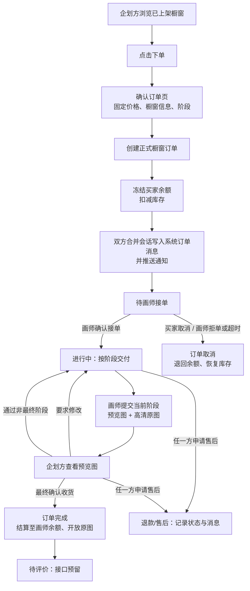
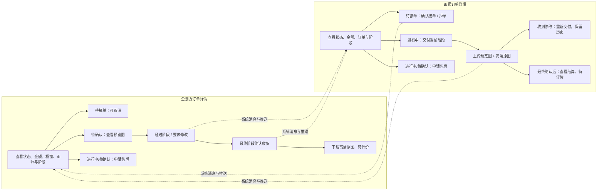

# 绘约（HuiYue）橱窗订单交易流程

> 版本：v1.0  
> 最后更新：2026-08-13  
> 范围：仅覆盖「橱窗下单 → 阶段交付 → 确认收货 → 评价预留」；企划应征属于后续企划订单的前置招标流程，本轮不实现。  
> 流程图源文件：[橱窗订单交易状态流转.mmd](橱窗订单交易状态流转.mmd)、[橱窗订单详情角色流程.mmd](橱窗订单详情角色流程.mmd)

## 1. 已确认业务规则

1. 橱窗价格固定，以已上架橱窗当前显示的价格为唯一订单金额；本轮不支持议价或修改订单金额。
2. 企划方点击橱窗“下单”后，先进入确认订单页，仅确认橱窗、价格、阶段及交易规则，不填写委托备注。
3. 确认下单即创建正式橱窗订单：冻结企划方余额、扣减橱窗库存，并向双方的**合并私聊会话**写入系统订单消息及推送通知。
4. 画师确认接单后，订单进入进行中；画师按橱窗预设 `phases` 逐阶段交付。
5. 每阶段由画师上传预览图与高清原图。当前阶段未通过前，企划方只能查看预览图；最终阶段确认收货后才开放高清原图。
6. 本轮不实现自动水印、压缩、防下载算法；预览图与原图分开上传、分别控制访问权限。
7. 企划方对每阶段可“通过”或“要求修改”；要求修改后画师重新提交，历史交付不覆盖。
8. 待接单阶段企划方可取消；画师可拒单或超时未接。上述情形均应退款并恢复库存。
9. 进行中或待确认阶段，任一方只能发起售后/退款，订单进入售后状态；本轮只记录状态、原因和双方消息，不开发管理员仲裁界面。
10. 最终阶段由企划方确认收货后，订单完成：冻结金额结算至画师余额，开放高清原图，双方进入待评价。评价接口和页面先预留，不在本轮完全实现。

## 2. 交易状态与资金、库存

| 状态 | 含义 | 余额 / 库存 | 可进入的下一状态 |
| --- | --- | --- | --- |
| 待画师接单 | 已创建订单，等待画师决定 | 买家余额已冻结；库存已扣减 1 | 进行中、已取消 |
| 进行中 | 画师已接单，等待当前阶段交付 | 继续冻结；库存不变 | 待确认、售后/退款 |
| 待确认 | 画师已提交当前阶段，等待企划方验收 | 继续冻结；库存不变 | 进行中、已完成、售后/退款 |
| 已完成 / 待评价 | 最终阶段已确认收货 | 结算至画师余额；库存不恢复 | 已评价（预留） |
| 已取消 | 待接单时取消、拒单或超时 | 解冻并退回买家；库存恢复 1 | 终态 |
| 退款/售后 | 进行中或待确认阶段的售后记录 | 金额保持冻结，等待后续处理 | 本轮仅记录，仲裁后续实现 |

## 3. 订单管理与详情页

订单管理按登录身份分别展示：

- 企划方：`/dashboard/orders`
- 画师方：`/painter/orders`

一级页签统一为“企划订单 / 橱窗订单”。本轮实现橱窗订单，企划订单仅保留入口与空状态。二级筛选统一为“全部订单 / 待交付 / 待评价 / 退款/售后”。

### 3.1 企划方订单详情

- 查看订单状态、固定金额、橱窗信息、画师信息、阶段进度和操作记录。
- 查看已提交阶段的预览图；最终确认收货后下载高清原图。
- 对当前阶段选择“通过”或“要求修改”。
- 最终阶段选择“确认收货”，推动结算和订单完成。
- 待接单时可取消；进行中或待确认时可申请售后/退款。
- 完成后展示“去评价”入口（预留）。

### 3.2 画师方订单详情

- 待接单时可“确认接单”或“拒单”。
- 接单后查看固定金额、订单要求、阶段进度和沟通记录。
- 依次提交阶段稿：预览图 + 高清原图。
- 收到“要求修改”后，对当前阶段再次提交，不覆盖历史版本。
- 最终阶段通过后查看结算结果；完成后展示“去评价”入口（预留）。

## 4. 会话与通知

1. 不为同一用户创建多个私聊分身；延续当前“同一用户一条合并私聊会话”的规则。
2. 下单、接单、拒单、取消、每次交稿、要求修改、阶段通过、最终确认、发起售后等事件，均需：
   - 写入订单操作记录；
   - 向双方合并私聊写入系统订单消息；
   - 创建站内推送通知；
   - 刷新订单管理列表与待办数量。
3. 系统订单消息携带 `orderId`、订单来源 `stall` 与事件类型；“查看详情”按当前身份跳转对应订单详情。
4. 聊天扩展栏预留“发送订单状态”按钮：选择双方关联的一笔订单后发送交易状态卡片，类似闲鱼交易卡片；不创建新的会话。

## 5. 两张流程图

### 5.1 橱窗订单交易状态流转

### 5.2 订单详情角色操作流程

## 6. 本轮明确不做

- 企划应征到订单的转换、企划订单实际流转；
- 议价和订单金额调整；
- 自动水印、原图防下载、真实支付渠道；
- 管理员售后仲裁；
- 完整评价提交与公开展示；
- 企划下架、删除功能（已登记为 P0，后续与企划订单流程一并处理）。

## 7. 2026-08-13 实施结果

本流程已按代码提交 `0105f7d` 完成首版实现，数据库迁移为 `backend/sql/migrations/20260813_stall_order_flow.sql`。

- 已实现：固定价下单、简化余额托管、库存扣减、画师接/拒单、企划方取消、多阶段交付与历史版本、修改/通过、最终结算、原图解锁、售后登记、订单事件、双方通知、会话系统消息和订单状态卡片。
- 已联调：测试订单 `#11` 完整走通全部正常路径，后端 32 项测试与前端生产构建通过。
- 与设计术语的差异：当前没有独立“冻结余额”字段，下单时直接扣除企划方可用余额；拒单/取消时返还，最终完成时增加画师余额。
- 仍按第 6 节保持未实现：评价正式提交、管理员售后仲裁、真实支付与资金流水、源文件上传、企划应征转订单。

## 8. 交付与提前完成规则调整（2026-08-13）

- 画师每次阶段交付只上传一张原图，不再分别上传预览图和高清原图。
- 服务端自动将该原图转换为最长边不超过 1080px 的低分辨率 JPEG，并叠加重复水印；企划方验收时只读取该预览图。
- 原图地址在订单完成前对企划方隐藏。企划方可以“通过并进入下一阶段”，也可以在初稿、修改稿等任意阶段选择“确认当前交付并完成交易”，直接跳过剩余阶段。
- 直接完成与正常终稿完成使用同一结算事务：订单状态改为已完成的同时，款项立即增加至画师余额，并向企划方开放本次交付原图。
- 企划方要求修改时必须填写意见；订单返回进行中，画师详情在对应提交卡片中显示修改意见。
- 画师不能申请退款/售后，只显示“联系客服”预留入口；退款/售后仍由企划方发起。
- 合并私聊中的“发送订单状态”不再自动选择第一笔订单，而是列出当前双方共同参与的全部订单供发送者选择。

本轮代码提交：`a86e14e feat: 优化订单单图交付与阶段确认`。
