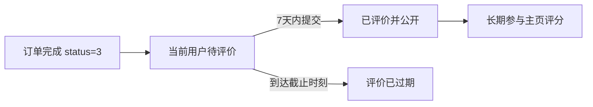
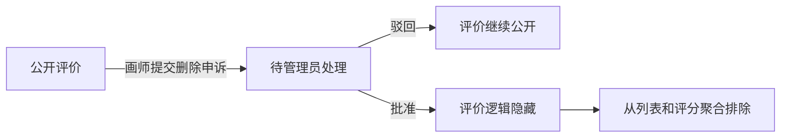

# 艺绘（Artiv）评价系统设计计划书

> 文档状态：需求与实施设计已形成，业务代码尚未开发
>
> 创建日期：2026-08-23
>
> 对应模块：F10 评价体系
>
> 适用范围：完成订单后的双方评价、公开评分展示、画师评价申诉与管理员处理

## 1. 目标与边界

评价系统用于补齐 Artiv 的完整交易闭环：

**订单完成 → 双方在 7 天内分别评价 → 评价进入对应身份主页与评分统计 → 画师可对收到的评价发起删除申诉 → 管理员审核并留下审计记录**

首期只实现与真实订单绑定的合作评价，不实现：

- 未发生交易的自由评价。
- 平台自动好评或逾期默认评分。
- 匿名评价。
- 评价点赞、回复、举报和“第 N 次合作”标记。
- 多维度评分、评价标签自动生成或推荐算法。
- 管理员直接修改星级、评价正文或评价图片。

## 2. 当前代码与数据现状

项目已经具备评价骨架，但不能直接作为正式功能开放：

- `review` 表已有 `order_id / from_id / to_id / score / content`，并有 `uk_order_from(order_id, from_id)` 唯一约束。
- `POST /api/v1/orders/{orderId}/review` 当前允许客户端提交 `toId`，服务端没有校验订单状态、交易参与方、真实评价对象和 7 天期限。
- `GET /api/v1/reviews` 当前直接返回评价实体，没有评价人公开资料、订单来源、图片和角色口径。
- 订单表已有 `status=3` 的完成状态与 `completed_at`，可作为评价资格和截止时间的唯一时间依据。
- 订单详情已有禁用的“去评价（接口预留）”按钮；订单列表已有“待评价”筛选，但尚未按当前登录人的实际评价状态区分。
- 公开画师/企划方主页已有“合作评价”标签页占位；画师大厅仍在昵称下显示 `@username`。
- 管理后台尚无评价申诉菜单、待办、数据结构和处理接口。

因此本模块属于在现有骨架上补正式业务规则，不是单纯打开前端按钮。

## 3. 已确认产品规则

### 3.1 评价资格与期限

1. 只有 `order_info.status = 3` 且未删除的完成订单允许评价。
2. 只有订单的企划方和画师可以评价，其他登录用户一律拒绝。
3. 评价对象必须由服务端根据订单和当前登录人推导，前端不得提交 `toId`。
4. 每位参与方对同一订单最多评价一次；双方互不影响，可以各自提交一条评价。
5. 评价期限为订单 `completed_at` 起 7×24 小时，服务端返回精确的 `reviewDeadline`。
6. 判断口径暂定为 `now < completed_at + 7 days` 时可提交；达到截止时刻后即过期。
7. 7 天内没有提交评价的一方不产生评价、不产生默认分，也不进入评分统计。
8. 在 7 天期限内成功提交的评价长期保留并持续参与平均分；“只记录 7 天的评价”解释为只接受完成后 7 天内提交的评价，而不是评价展示 7 天后自动消失。

### 3.2 评价内容

- 星级：必填整数，范围 `1–5`，最高展示为 `5.0`。
- 文字：选填，最多 500 字；按纯文本显示，不解析 HTML。
- 图片：选填，首期暂定最多 6 张，沿用现有上传接口；按上传顺序展示，可打开站内大图预览。
- 一次提交成功后普通用户不能编辑、撤回或重新提交，避免事后反复改分。
- 评价提交后立即公开，不增加“双盲等待双方完成”机制。

### 3.3 评分统计

- 平均分只统计当前公开、未删除的有效评价。
- 按公开主页身份分别统计：画师身份只统计其作为画师收到的评价，企划方身份只统计其作为企划方收到的评价，不能因同一账号可切换身份而混算。
- 平均分使用一位小数，例如 `4.8`；评价数展示有效评价总数。
- 没有有效评价时，接口返回 `averageScore = null`、`reviewCount = 0`，不能返回虚构的 `0.0`。
- 申诉处理中评价仍公开并参与统计；管理员批准删除后才从列表和平均分中排除。

### 3.4 评价申诉

- 首期按已确认范围，只允许画师对自己以画师身份收到的评价申请删除。
- 申请人必须是该评价对应订单的画师，不能替其他用户申诉。
- 一条评价最多创建一笔申诉，避免驳回后反复提交相同事项。
- 画师填写删除理由；管理员可查看评价、评价图片、订单双方、订单来源和申诉理由，但不默认读取双方无关私聊。
- 管理员只能“批准删除”或“驳回申诉”，必须填写处理原因。
- 批准后对评价做逻辑隐藏，不物理删除评价、图片、申诉或订单历史；评分聚合立即排除该评价。
- 驳回后评价保持公开且继续参与评分。
- 两种处理结果都向画师发送系统通知；批准删除时同时通知原评价人。
- 处理动作写入 `admin_action_log`，包含管理员、申诉、评价、订单、结果和原因。

## 4. 评价展示位置分析

### 4.1 首期必须实现

| 页面 / 区域 | 展示内容 | 无评价时 | 原因 |
| --- | --- | --- | --- |
| 公开主页头部 `/profiles/{id}?role=...` | 平均分、5 星视觉和评价数 | 整块不显示，不显示“暂无”或 `0.0` | 用户已明确要求只在存在评价时显示平均分 |
| 公开主页“合作评价”标签页 | 分页评价列表 | 简洁空状态 | 评价的主要公开承载页 |
| 画师大厅 `/artists` | 用“星级 + 平均分 + 评价数”替换当前 `@username` | 显示“暂无评价”，不再显示账号名 | 保持列表信息行高度并帮助选择画师 |
| 企划详情应征画师卡 | 紧凑平均分与评价数 | 显示“暂无评价” | 企划方选定画师前的重要决策信息 |
| 橱窗详情右侧画师卡 | 紧凑平均分与评价数 | 显示“暂无评价” | 企划方下单前的重要决策信息 |
| 企划方公开主页 | 与画师主页一致，展示企划方身份收到的评价 | 头部不显示评分，标签页显示空状态 | 双方互评必须有对称的公开去向 |
| 订单详情 | 当前用户的评价截止时间、待评价/已评价/已过期状态和提交入口 | 不适用 | 这是评价动作入口，不展示对方总评分 |
| 订单列表“待评价”筛选 | 只包含当前用户尚未评价且仍在 7 天期限内的完成订单；每张订单卡右侧操作区直接显示“去评价”按钮 | 正常空状态 | 无需先进入订单详情即可评价，同时避免把所有历史完成订单误列为待评价 |
| 管理后台概览与评价申诉页 | 待处理数量、申诉列表、详情与处理操作 | 0 条待办 | 完成治理闭环 |

### 4.2 首期不增加评分的位置

- 首页认证画师卡：已有简介、标签和作品预览，首期不再增加评分，避免首页信息过密；后续可复用画师摘要字段。
- 作品广场和作品详情：重点是作品内容，进入作者主页后再看合作评价。
- 消息列表与聊天顶部：评价不是沟通状态，不应持续占用聊天空间。
- 橱窗大厅每张橱窗卡：当前已包含封面、标题、分类、销量、画师和价格；评分放在详情页画师卡即可。
- 普通订单卡：默认只展示订单自身状态；进入“待评价”筛选后，符合资格的订单卡例外增加“去评价”直接操作。

## 5. 公开主页评价样式

### 5.1 主页头部

- 评分放在昵称与身份标签附近，格式建议为 `★★★★★ 4.8（12 条评价）`。
- 星形使用项目图标库或 CSS 图标，不使用 Emoji。
- 只有 `reviewCount > 0` 时渲染整个评分块。
- 画师与企划方切换身份时重新读取对应身份的平均分，不能沿用另一身份数据。

### 5.2 合作评价列表

单条评价按以下信息层级展示：

1. 评价人头像与昵称。
2. 1–5 星评分。
3. 订单来源类型：`企划订单` 或 `橱窗订单`。
4. 订单标题快照，只展示文字，不允许跳转订单、企划或橱窗。
5. 评价正文。
6. 0–6 张评价图片，点击只打开图片预览。
7. 评价日期。

链接边界：

- 唯一允许导航的元素是评价人头像。
- 点击头像使用新标签页打开 `/profiles/{reviewerId}?role={reviewerRole}`。
- 昵称、星级、订单来源、标题、正文和日期均不可点击。
- 公开响应不返回订单金额、私聊内容、内部订单事件或双方账户字段。

## 6. 状态流转

### 6.1 评价状态



评价资格不新增定时任务。订单详情和列表查询时由服务端根据 `completed_at`、当前时间和是否已有评价计算，避免维护容易失真的冗余订单状态。

### 6.2 申诉状态



申诉处理中不隐藏评价；管理员处理使用状态条件更新，重复批准或驳回必须被拒绝。

## 7. 数据库设计

### 7.1 保留并加强 `review`

沿用现有字段和 `uk_order_from(order_id, from_id)`，不重建历史评价表。实施时至少补充索引：

```text
idx_review_to_visible_created(to_id, deleted, created_at)
idx_review_order_visible(order_id, deleted)
```

业务约束由服务层和唯一索引共同保证：

- `from_id` 只能取当前登录用户。
- `to_id` 只能由订单另一方推导。
- `order_id` 必须对应已完成订单。
- 平均分查询必须按订单中的接单/下单身份区分角色。

### 7.2 新增 `review_image`

| 字段 | 说明 |
| --- | --- |
| `id` | 主键 |
| `review_id` | 评价 ID |
| `image_url` | 项目上传目录内的图片相对路径 |
| `sort_order` | 展示顺序，0 开始 |
| `created_at` | 创建时间 |

索引和约束建议：

- `idx_review_image_review(review_id, sort_order)`。
- 同一评价最多 6 条图片记录，服务端事务内校验。
- 图片 URL 必须是本项目上传接口产生的允许路径，不能接受任意外部 URL。

### 7.3 新增 `review_appeal`

| 字段 | 说明 |
| --- | --- |
| `id` | 主键 |
| `review_id` | 被申诉评价 ID，唯一 |
| `applicant_id` | 申诉画师用户 ID |
| `reason` | 申诉理由，最多 500 字 |
| `status` | `0 待处理 / 1 已批准 / 2 已驳回` |
| `admin_id` | 处理管理员 |
| `decision_reason` | 管理员处理原因 |
| `decided_at` | 处理时间 |
| `created_at / updated_at` | 创建与更新时间 |

使用 `UNIQUE(review_id)` 保证一条评价最多一笔申诉；列表索引使用 `(status, created_at)`。

### 7.4 迁移规则

- 新增带日期的增量迁移，例如 `backend/sql/migrations/20260823_review_system.sql`。
- 同步更新 `backend/sql/init.sql`，保证全新建库结构一致。
- 迁移不删除现有评价；现有记录保持可追溯。
- 迁移脚本应可重复执行或明确通过表/列存在性保护，先在当前 MySQL 8 测试库验证。

## 8. 接口规划

### 8.1 订单评价

| 方法 | 路径 | 权限 | 说明 |
| --- | --- | --- | --- |
| POST | `/api/v1/orders/{orderId}/reviews` | 订单参与方 | 提交当前用户对交易另一方的评价，不接收 `toId` |
| GET | `/api/v1/orders/{orderId}` | 订单参与方 | 在现有订单详情 DTO 中补充当前用户评价状态、截止时间和已提交评价摘要 |

提交请求建议：

```json
{
  "score": 5,
  "content": "沟通顺畅，交付符合预期。",
  "images": ["/uploads/reviews/example-1.jpg"]
}
```

订单详情建议新增：

```json
{
  "reviewStatus": "PENDING",
  "reviewDeadline": "2026-08-30T12:00:00",
  "viewerReview": null
}
```

`reviewStatus` 取值为 `NOT_AVAILABLE / PENDING / SUBMITTED / EXPIRED`。

### 8.2 公开列表与评分

| 方法 | 路径 | 权限 | 说明 |
| --- | --- | --- | --- |
| GET | `/api/v1/users/{userId}/reviews?role=painter&page=1&size=10` | 匿名 | 按主页身份分页查询收到的公开评价 |
| GET | `/api/v1/users/{userId}/public-profile?role=...` | 匿名 | 现有响应增加 `averageScore` 与 `reviewCount` |
| GET | `/api/v1/artists` | 匿名 | 画师摘要批量增加 `averageScore` 与 `reviewCount` |

企划应征摘要 `ApplicantPainterSummary` 同步增加相同聚合字段；橱窗详情当前已读取公开主页，可直接复用公开主页评分，不另做逐条评价查询。

公开评价响应使用专用 DTO，不直接返回 `Review` 实体：

```json
{
  "id": 18,
  "score": 5,
  "content": "沟通顺畅，交付符合预期。",
  "images": ["/uploads/reviews/example-1.jpg"],
  "sourceType": "PROJECT",
  "sourceTitle": "角色立绘企划",
  "reviewer": {
    "id": 7,
    "nickname": "企划小张",
    "avatar": "/uploads/avatars/7.jpg",
    "role": "employer"
  },
  "createdAt": "2026-08-23T18:20:00"
}
```

### 8.3 评价申诉与管理员接口

| 方法 | 路径 | 权限 | 说明 |
| --- | --- | --- | --- |
| POST | `/api/v1/reviews/{reviewId}/appeals` | 评价对应画师 | 提交删除申诉 |
| GET | `/api/v1/reviews/{reviewId}/appeal` | 评价对应画师 | 查看本人申诉状态 |
| GET | `/api/v1/admin/review-appeals` | 管理员 | 按状态、画师昵称、时间分页筛选 |
| GET | `/api/v1/admin/review-appeals/{appealId}` | 管理员 | 查看评价、订单和申诉详情 |
| PUT | `/api/v1/admin/review-appeals/{appealId}/approve` | 管理员 | 批准并逻辑隐藏评价 |
| PUT | `/api/v1/admin/review-appeals/{appealId}/reject` | 管理员 | 驳回申诉 |

现有 `GET /api/v1/reviews` 与 `POST /api/v1/orders/{orderId}/review` 在新接口完成并迁移前继续标记为“骨架”；实施后移动到《接口文档》末尾的“已弃用接口”，不直接删除历史说明。

## 9. 后端权限、事务与幂等

提交评价必须按以下顺序处理：

1. 从 JWT 读取当前用户。
2. 查询未删除订单并校验 `status=3`、`completed_at` 非空。
3. 校验当前用户等于 `employer_id` 或 `painter_id`。
4. 由订单推导另一方为 `to_id`，禁止请求体覆盖。
5. 校验当前时间早于 `completed_at + 7 days`。
6. 校验评分、文字和图片；拒绝非本站上传路径。
7. 在同一事务写入评价与图片。
8. 通过 `uk_order_from` 兜底并发重复提交，将唯一键冲突转换为明确业务错误。

申诉批准必须在同一事务中：

- 以 `status=0` 条件锁定并更新申诉终态。
- 将评价 `deleted` 更新为 1。
- 写管理员审计记录。
- 写系统通知；事务提交后再进行 WebSocket 定向推送。

重复批准、重复驳回或批准已隐藏评价不能重复改变数据。

## 10. 前端开发范围

### 10.1 两个评价入口

评价提交必须同时提供以下两个入口，企划方和画师共用同一规则：

1. **订单详情入口**：`/painter/orders/{id}` 与 `/dashboard/orders/{id}` 的订单摘要操作区，在 `reviewStatus=PENDING` 时显示“去评价”按钮；完成订单同时显示评价截止时间。已评价显示本人评价摘要，过期显示“评价已过期”，不再提供按钮。
2. **待评价列表入口**：`/painter/orders` 与 `/dashboard/orders` 选择“待评价”筛选后，在每张符合资格的订单卡右侧操作区、现有“橱窗详情 / 企划详情 / 订单详情”按钮之前增加“去评价”按钮，即页面注释位置。

两个入口的交互规则：

- 都打开同一个可复用评价对话框，包含 5 星选择、文字、最多 6 图和提交确认，不维护两套表单逻辑。
- 列表按钮需要阻止订单卡默认点击事件，点击“去评价”不能先跳入订单详情。
- 提交成功后刷新订单评价状态；在“待评价”筛选中，该订单应立即移出当前列表。
- 若页面停留期间刚好超过截止时间，以服务端结果为准，提示评价已过期并刷新列表。
- 服务端错误仍是最终权限判断，前端倒计时和按钮隐藏不能替代后端校验。

### 10.2 公开主页和大厅

- 公开主页接入评分聚合与评价分页，空数据不显示头部评分。
- 评价图片使用现有大图预览；唯一导航为评价人头像的新标签页主页。
- 画师大厅移除 `@username` 展示，替换为真实评分或“暂无评价”。
- 企划应征卡与橱窗详情画师卡复用同一紧凑评分组件，避免三处格式漂移。

### 10.3 画师申诉

- 画师查看自己的画师主页评价时，每条收到的评价显示“申请删除”操作。
- 已申诉时显示“处理中 / 已批准 / 已驳回”，不重复提交。
- 申诉对话框只收集删除理由，首期不新增申诉图片上传。

### 10.4 管理后台

- 新增侧边栏“评价申诉”，路由建议 `/admin/review-appeals`。
- 概览新增“待处理评价申诉”待办卡，点击进入待处理筛选。
- 列表字段：申诉时间、画师、原评价人、星级、订单来源、状态。
- 详情使用现有后台抽屉/对话框模式，展示评价、图片、申诉理由、订单摘要和处理记录。
- 批准/驳回均需二次确认和必填处理原因；普通用户手工请求管理员接口必须被服务端拒绝。

## 11. 聚合与性能规则

- 画师大厅、首页画师摘要和应征列表禁止对每个画师逐条调用评分接口。
- 后端使用按用户 ID 分组的批量聚合查询，一次返回 `AVG(score)` 与 `COUNT(*)`，再合并到列表 DTO。
- 公开主页单用户聚合可与主页响应同查询；评价列表单独分页。
- 平均分和评价数首期实时聚合，不新增容易失真的缓存字段。
- 评价图片一次批量查询当前页所有 `review_id`，避免 N+1。

## 12. 消息与审计

首期建议产生以下系统通知：

- 收到新的合作评价：发给被评价人，跳转对应身份公开主页的合作评价标签。
- 评价申诉已提交：发给画师，跳转本人评价页。
- 申诉已批准 / 已驳回：发给画师；批准时另发给原评价人。

评价提交属于普通业务事件，不写管理员审计；申诉终态处理必须写 `admin_action_log`。

## 13. 测试与验收标准

### 13.1 后端自动化

- 完成订单的企划方和画师均可各提交一次评价。
- 进行中、待验收、取消、争议中订单不能评价。
- 非订单参与方不能评价；伪造 `toId` 的旧请求不能改变评价对象。
- 完成后第 6 天可评，第 7 天精确边界过期。
- 同一方重复或并发提交只成功一次。
- 评分 0、6、小数、超长文字、超过 6 图和外部 URL 被拒绝。
- 画师/企划方评分按角色分开，删除评价后平均分和数量立即变化。
- 非评价对应画师不能申诉；普通用户不能访问管理员申诉接口。
- 管理员重复处理只生效一次，审计与通知不重复。

### 13.2 前端与浏览器

- 无评价主页不显示评分块；有评价显示一位小数和正确数量。
- 画师大厅不再显示账号名，显示真实评分或“暂无评价”。
- 评价列表只有头像能打开新标签页；标题和正文不能导航。
- 图片顺序正确，大图预览不离开当前主页。
- 订单列表“待评价”只包含当前用户仍可评价的订单。
- 订单详情和待评价订单卡的“去评价”按钮打开同一个评价对话框；列表按钮不会触发订单卡跳转。
- 从待评价列表提交成功后订单立即移出当前列表；截止时间已过时按钮不能绕过服务端校验。
- 评价提交、过期和已提交状态刷新后保持一致。
- 画师申诉与管理员批准/驳回页面均有加载、空数据、错误和无权限状态。

### 13.3 完整链路

使用两个普通账号和一个管理员账号验证：

1. 完成一笔企划订单和一笔橱窗订单。
2. 双方分别提交不同星级、文字和图片评价。
3. 核对双方身份主页、画师大厅、应征卡和橱窗画师卡评分。
4. 画师对一条收到的评价发起申诉。
5. 管理员先验证驳回，再使用另一条评价验证批准删除。
6. 核对公开列表、平均分、系统通知和审计日志只变化一次。

## 14. 建议开发顺序

1. 新增迁移、实体、DTO、Mapper 与聚合查询。
2. 重写评价 Service 的订单权限、7 天期限、目标推导、事务和防重复规则。
3. 接入订单详情评价上下文、正式提交接口，以及订单详情和待评价订单卡两个共用评价入口。
4. 接入公开主页评价列表和评分聚合。
5. 接入画师大厅、应征卡、橱窗详情的批量/复用评分展示。
6. 新增画师申诉和管理员处理闭环、通知与审计。
7. 更新《接口文档》《项目进度》《测试》《未解决问题》并完成后端测试、前端构建与三账号浏览器验收。

## 15. 开发前待最终确认

以下三项不影响本设计主体，若没有新的产品决定，实施时采用括号内默认值：

1. 评价图片上限：默认最多 6 张。
2. 评价申诉期限：默认首期不限时间，但一条评价只能申诉一次。
3. 企划方收到画师评价后是否也可申诉：当前按已确认范围仅画师可申诉，企划方不开放入口。

## 16. 当前结论

本文件完成的是 F10 的需求、页面、数据、接口、安全边界和验收设计。评价业务代码、数据库迁移、管理员页面和测试均尚未实现；在相关代码与验证完成前，README、项目进度和接口文档仍必须把 F10 标记为未完成。
